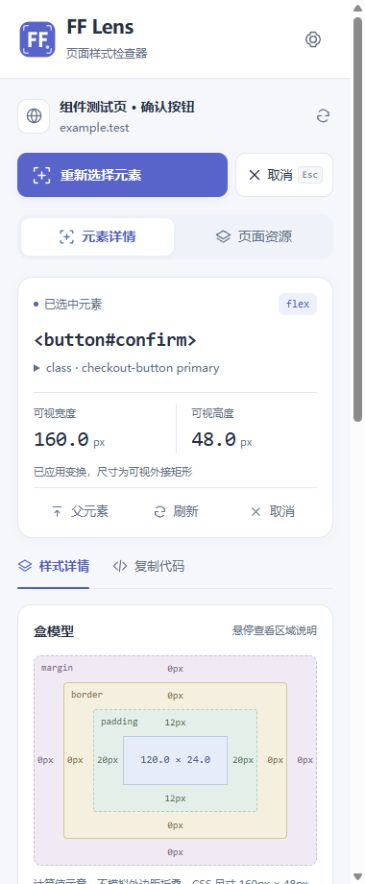

# FF Lens

**看清页面背后的样式。**

FF Lens 是一款面向前端开发与界面设计的 Chrome 侧边栏扩展。选中网页元素，即可查看字体、颜色、尺寸、间距与布局，并将计算样式整理成 CSS 或 Tailwind CSS 类名，方便调试、参考与复用。

所有分析均在本地执行，无需账号、后端或 API 密钥，不上传页面数据。



## 功能

| 功能          | 说明                                                                            |
| ------------- | ------------------------------------------------------------------------------- |
| 元素拾取      | 悬停高亮、点击选中，支持查看父元素、刷新样式，以及在网页或侧边栏按 Esc 取消选择 |
| 样式检查      | 按字体、颜色、盒模型、布局、Flex、Grid、外观与效果分组查看计算值                |
| CSS 导出      | 自定义选择器、选择样式分组、过滤常见默认值、合并简写，或读取完整计算样式        |
| HEX 转换      | 将 RGB / RGBA 转为 HEX，支持边框、阴影与渐变，透明度保留为 8 位 HEX             |
| Tailwind 导出 | 支持 v3.4 / v4，优先匹配标准工具类，无法匹配时保留任意值，复杂值提供补充 CSS    |
| 页面资源      | 主动扫描颜色、字体、字号与字重及其出现次数，支持导出 CSS 变量和 JSON            |
| 主题与交互    | 浅色与深色主题，优先使用本机苹方字体，支持键盘操作与减少动态效果偏好            |

## 安装

需要 **Chrome 116 或更高版本**。

1. 下载并解压 [本地安装包 v1.2.2](release/ff-lens-1.2.2.zip)，或按下文从源码构建。
2. 打开 `chrome://extensions`，开启右上角的「开发者模式」。
3. 点击「加载已解压的扩展程序」，选择解压后包含 `manifest.json` 的目录；从源码构建时选择 `dist`。
4. 打开需要检查的网页，点击浏览器工具栏中的 **FF Lens** 图标，打开侧边栏并授予当前页的临时访问权限。

建议将扩展固定到工具栏，方便切换页面后重新授权。

## 使用

### 检查元素

点击「选择页面元素」，将鼠标移到目标上查看高亮，再点击选中。在侧边栏查看样式与盒模型，需要退出时按 `Esc` 或点击取消按钮。

页面布局或内容发生变化后，可以刷新所选元素；也可以切换到父元素，继续查看容器样式。

### 复制 CSS

进入「复制代码」，选择 **CSS**。导出规则名默认为 `.element`，可改为 `.card`、`#submit` 等有效选择器；它只用于生成代码，不修改原网页。

展开「导出设置」可调整以下选项，预览与复制结果保持同步：

- **包含的样式**：选择需要导出的分组。
- **过滤默认值**：默认开启，精简透明背景、零间距、无边框等常见初始值。需要保留重置声明时可关闭。
- **合并简写**：默认开启，合并 padding、margin 和统一边框，保留负值与不对称边框。
- **颜色转 HEX**：将 RGB / RGBA 转为 HEX；例如 `rgba(0, 0, 0, 0.5)` 转为 `#00000080`。字符串、图片 URL 和其他色彩空间保持原值。
- **完整计算样式**：读取全部计算样式，不进行分组过滤、默认值过滤或简写合并；仍可选择 HEX 转换。

默认值过滤依据计算值，无法判断原 CSS 是否显式声明。将结果粘贴到不同页面时，可能需要补充重置样式。

### 复制 Tailwind CSS

选择 **Tailwind CSS**，并指定项目使用的 v3.4 或 v4。默认按对应版本的默认主题与 `1rem = 16px` 匹配标准工具类，例如 `text-base`、`font-medium`、`py-3 px-5`；特殊尺寸不取整，无法匹配时使用任意值。

关闭「优先标准工具类」可使用精确值模式。无法安全编码的复杂值会单独列出，可通过「复制补充 CSS」获取。

将类名粘贴到项目的 `class` / `className`，并确保文件位于 Tailwind 构建器的扫描范围内。含反斜杠的类名在 JSX 中可使用 `String.raw` 保留转义。自定义主题和已有类可能影响还原效果。

### 扫描页面资源

进入「页面资源」主动开始扫描，查看颜色、字体、字号与字重的统计结果，按需复制 JSON、下载 JSON 或导出 CSS 变量。扫描支持取消；页面发生变化后需重新扫描。

## 常见问题

### 提示无法访问页面或尚未授权

请在目标网页点击浏览器工具栏里的 **FF Lens** 图标。未固定时，可在拼图菜单中找到它。

侧边栏中的「重新连接」和「选择页面元素」不能授予 `activeTab` 权限。页面导航或切换标签后，可能需要再次点击工具栏图标。浏览器内部页面和 Chrome 扩展商店等受保护页面无法检查；本地文件需要在扩展详情中开启「允许访问文件网址」。

### 更新后没有生效

重新构建或替换安装目录后，在 `chrome://extensions` 点击 FF Lens 的「重新加载」，刷新目标网页，再点击工具栏图标。仅刷新侧边栏不能更新后台和页面脚本。

### 复制失败

界面会提供可选中的文本框，可手动选择并复制代码。

## 开发

技术栈：**React 19 · TypeScript · Vite · Manifest V3 · Chrome Side Panel**。

需要 Node.js 22.18+，建议使用 Node.js 24。

```sh
npm ci
npm run dev
```

开发服务器用于预览侧边栏 UI；实际网页检查需要加载扩展。

```sh
npm run typecheck
npm run format:check
npm test
npm run build
```

构建产物位于 `dist`。如需打包，将 `dist` 内的文件压缩为 ZIP，确保 `manifest.json` 位于压缩包根目录。

### 测试入口

| 地址                  | 用途                                                                               |
| --------------------- | ---------------------------------------------------------------------------------- |
| `/test-page.html`     | 页面检查验收，覆盖 Flex / Grid、透明度、负间距、变换、滚动、动态删除与拾取交互保护 |
| `/tests/panel.html`   | 侧边栏组件预览，Chrome API 使用测试替身                                            |
| `/tests/content.html` | DOM 拾取交互验证，消息 API 使用测试替身                                            |

`tests` 下的开发入口不会进入扩展构建。Tailwind 两个版本的编译器仅用于开发测试，不打包到扩展中。

当前 v1.2.2 已通过类型检查、格式检查、生产构建和 22 项自动化测试，包括 CSS 简写、HEX 转换、Esc 监听清理及 Tailwind v3 / v4 实际编译验证。组件与 DOM 预览检查使用测试消息层；真实 Chrome 扩展的授权、注入及完整端到端流程仍需单独验收，Edge 兼容性尚未实测。

## 支持范围

- 检查主文档中的普通 DOM，不深入 iframe 或 Shadow DOM，不解析图片、Canvas、视频及伪元素。
- 导出的是当前计算样式快照，不包含原始 CSS 来源、级联关系、响应式断点或 hover 状态规则，也不会生成完整组件。
- 单次扫描最多统计 5,000 个参与布局的节点，超限时标注部分结果。
- 字体列表反映计算样式中的字体声明，不代表实际绘制字体；透明背景不推断底色，不模拟外边距折叠。
- 元素变换后的尺寸展示为可视外接矩形。

## 隐私与权限

FF Lens 不使用远程脚本、统计服务或账号系统，不读取输入框值、密码、Cookie 或 Token。样式分析在当前标签页本地执行，导出由用户主动触发。

| 权限        | 用途                               |
| ----------- | ---------------------------------- |
| `activeTab` | 点击扩展后临时访问当前网页         |
| `scripting` | 注入本地页面检查脚本               |
| `sidePanel` | 显示检查侧边栏                     |
| `storage`   | 在本地保存主题与 Tailwind 版本偏好 |

不申请所有网站的永久访问权限。详情见 [隐私说明](PRIVACY.md)。

## 许可证

[MIT](LICENSE)
